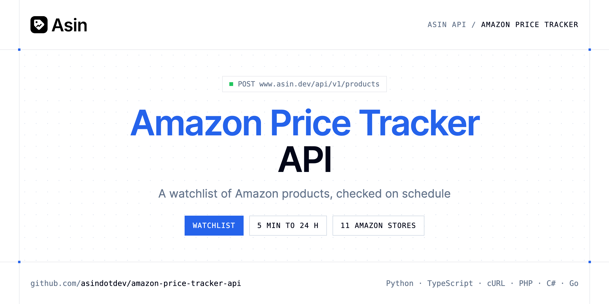

<p align="center">
  <a href="https://www.asin.dev"></a>
</p>

# Amazon Price Tracker API

[](https://www.asin.dev/signup) [](https://www.asin.dev/docs) [](LICENSE)

The **Asin Amazon Price Tracker API** manages a watchlist of Amazon products: add an ASIN or a link, get each product checked on schedule, then read, change, re-check or remove it.

- **Track a Product** — Adds an ASIN, an Amazon link or a short link (amzn.to, a.co…) to your watchlist.
- **List Tracked Products** — Your watchlist, newest first, with each product's latest state and its recent prices (trend).
- **Get a Tracked Product** — The product's latest state and every price read of the period, oldest first.
- **Change Alerts and Checks** — Target price, drop alerts, check interval, or pause.
- **Check the Price Now** — Asks for a check right away (1 credit), at most once per 5 minutes; earlier calls return the product unchanged.
- **Stop Tracking a Product** — Removes the product and its price history.
- **Plan and Remaining Credits** — Your plan, the credits left (monthly allowance and packs), how many products you track and the credits they use per month.

Use it for price monitoring, competitor tracking, deal apps and internal dashboards, on 11 Amazon stores.

| Endpoint | Request | Cost |
|---|---|---|
| [Track a Product](#track-a-product) | `POST /products` | 1 credit per price check |
| [List Tracked Products](#list-tracked-products) | `GET /products` | No credit |
| [Get a Tracked Product](#get-a-tracked-product) | `GET /products/{id}` | No credit |
| [Change Alerts and Checks](#change-alerts-and-checks) | `PATCH /products/{id}` | No credit |
| [Check the Price Now](#check-the-price-now) | `POST /products/{id}/check` | 1 credit |
| [Stop Tracking a Product](#stop-tracking-a-product) | `DELETE /products/{id}` | No credit |
| [Plan and Remaining Credits](#plan-and-remaining-credits) | `GET /account` | No credit |

## Table of contents

- [How it works](#how-it-works)
- [Track a Product](#track-a-product)
- [List Tracked Products](#list-tracked-products)
- [Get a Tracked Product](#get-a-tracked-product)
- [Change Alerts and Checks](#change-alerts-and-checks)
- [Check the Price Now](#check-the-price-now)
- [Stop Tracking a Product](#stop-tracking-a-product)
- [Plan and Remaining Credits](#plan-and-remaining-credits)
- [Code examples in other languages](#code-examples-in-other-languages)
- [Use cases](#use-cases)
- [Why Asin?](#why-asin)
- [FAQ](#faq)
- [Official SDKs](#official-sdks)
- [Related repositories](#related-repositories)
- [Support](#support)

## How it works

1. **[Create an Asin account](https://www.asin.dev/signup)** and copy your API key from [your account](https://www.asin.dev/app#api).
2. **Call `https://www.asin.dev/api/v1`** with the header `Authorization: Bearer YOUR_API_KEY`.
3. **Use the result** in your app, or let Asin email you when a price moves.

```bash
export ASIN_API_KEY="your-api-key"
pip install requests        # Python
# TypeScript: Node.js 18+ (native fetch), run with `npx tsx file.ts`
```

## Track a Product

Adds an ASIN, an Amazon link or a short link (amzn.to, a.co…) to your watchlist. The first check runs in the background within seconds (checking is true until then): poll GET /products/{id}, or send wait: true to get the answer once it's done (up to 45 seconds). Each price check of a tracked product costs 1 credit; a product checked daily uses about 30 credits a month. Without credits the product is added and its first check waits. What Amazon answers shows on the product (last_error), never as an error here. Adding a product you already track returns it unchanged, with status 200.

`POST https://www.asin.dev/api/v1/products` · **1 credit per price check** · [API reference](https://www.asin.dev/docs)

### Request parameters

| Parameter | In | Type | Required | Description |
|---|---|---|---|---|
| `product` | body | string | ✅ | ASIN (B09DFCB66S) or Amazon product link |
| `marketplace` | body | string (`com`, `co.uk`, `de`, `fr`, `it`, `es`) | — | Amazon store, e.g. com for amazon.com. A product link sets it on its own. |
| `target_price` | body | number | — | Email the owner when the price goes at or below this amount. null removes it. |
| `interval_minutes` | body | integer (`5`, `30`, `60`, `360`, `720`, `1440`) | — | Minutes between two checks (1440 = daily). Checks faster than daily need a plan or a credit pack: every 60 minutes with a pack or Starter, 30 with Pro, 5 with Business. |
| `wait` | body | boolean | — | Answer once the first check is done (up to 45 seconds) |

### Python example

```python
import os

import requests

API_KEY = os.environ["ASIN_API_KEY"]
HEADERS = {"Authorization": f"Bearer {API_KEY}"}

response = requests.post(
    "https://www.asin.dev/api/v1/products",
    headers=HEADERS,
    json={'product': 'B09DFCB66S', 'marketplace': 'com', 'wait': True},
    timeout=120,
)
response.raise_for_status()

data = response.json()
print(data)
```

### TypeScript example

```typescript
type TrackAProduct = {
  product_id?: string;
  asin?: string;
  marketplace?: string;
  url?: string;
  title?: string;
  image?: string;
  brand?: string;
  currency?: string;
  price?: number;
  first_price?: number;
  lowest_price?: number;
  highest_price?: number;
  in_stock?: boolean;
  stock?: string;
  coupon?: string;
  seller?: string;
  best_sellers_rank?: string;
  target_price?: number;
  alert_on_drop?: boolean;
  interval_minutes?: number;
  status?: string;
  last_error?: string;
  found_on?: string[];
  checking?: boolean;
  last_checked_at?: string;
  [key: string]: unknown;
};

const headers = { Authorization: `Bearer ${process.env.ASIN_API_KEY!}`, "Content-Type": "application/json" };

const response = await fetch("https://www.asin.dev/api/v1/products", {
  method: "POST",
  headers,
  body: JSON.stringify({
  "product": "B09DFCB66S",
  "marketplace": "com",
  "wait": true
}),
});
if (!response.ok) throw new Error(`HTTP ${response.status}: ${await response.text()}`);

const data = (await response.json()) as TrackAProduct;
console.log(data);
```

### Output example

Example response from the API reference, abridged.

```json
{
  "product_id": "8f0b3c7e-2a4d-4e51-9c1a-6d2f1b9e7a30",
  "asin": "B09DFCB66S",
  "marketplace": "com",
  "url": "https://www.amazon.com/dp/B09DFCB66S",
  "title": "Wireless Earbuds, Bluetooth 5.3, Noise Cancelling",
  "image": "https://m.media-amazon.com/images/I/…jpg",
  "brand": "Example Audio",
  "currency": "USD",
  "price": 79.99,
  "first_price": 99.99,
  "lowest_price": 74.5,
  "highest_price": 99.99,
  "in_stock": true,
  "stock": "In Stock",
  "coupon": null,
  "seller": "example",
  "best_sellers_rank": "#152 in Electronics",
  "target_price": 70,
  "alert_on_drop": true,
  "interval_minutes": 1440,
  "status": "active",
  "last_error": null,
  "found_on": [],
  "checking": false,
  "last_checked_at": "2026-11-03T08:00:12.441Z"
}
```

### Response fields

| Field | Type | Description |
|---|---|---|
| `product_id` | string | Id of this watchlist entry |
| `asin` | string | Amazon's 10-character product code |
| `marketplace` | string | Amazon store |
| `url` | string | Product page on Amazon |
| `title` | string | null until the first check |
| `image` | string | Main product image |
| `brand` | string | Brand shown by Amazon |
| `currency` | string | ISO code, e.g. USD, EUR, JPY |
| `price` | number | Latest price; null when there is no offer |
| `first_price` | number | Price at the first check |
| `lowest_price` | number | Lowest price seen |
| `highest_price` | number | Highest price seen |
| `in_stock` | boolean | null until the first check |
| `stock` | string | Amazon's availability text |
| `coupon` | string | Coupon shown on the page, if any |
| `seller` | string | Seller of the offer shown (Buy Box) |
| `best_sellers_rank` | string | Main Best Sellers Rank |
| `target_price` | number | Alert threshold |
| `alert_on_drop` | boolean | Email when the price drops or the product is back in stock |
| `interval_minutes` | integer | Minutes between two checks |
| `status` | string | Paused products aren't checked |
| `last_error` | string | Why the last check didn't go through, if it didn't |
| `found_on` | string[] | When last_error is product_not_found: marketplaces where the ASIN exists |
| `checking` | boolean | A check is due or running; poll until it's false |
| `last_checked_at` | string | When the last check ran |

## List Tracked Products

Your watchlist, newest first, with each product's latest state and its recent prices (trend). Filter with asin (and marketplace) to know if a product is tracked, or with filter to get the same lists as the app's tabs.

`GET https://www.asin.dev/api/v1/products` · **No credit** · [API reference](https://www.asin.dev/docs)

### Request parameters

| Parameter | In | Type | Required | Description |
|---|---|---|---|---|
| `asin` | query | string | — | Only this ASIN |
| `marketplace` | query | string (`com`, `co.uk`, `de`, `fr`, `it`, `es`) | — | Only this Amazon store |
| `filter` | query | string (`all`, `drops`, `target`, `out_of_stock`, `attention`, `paused`) | — | Only the products of one of the app's watchlist filters. all: Every tracked product (default). drops: Cheaper now than when the product was added. target: At or below its target price. out_of_stock: No offer at the last … |
| `page` | query | integer | — | Page number |
| `limit` | query | integer | — | Products per page |

### Python example

```python
import os

import requests

API_KEY = os.environ["ASIN_API_KEY"]
HEADERS = {"Authorization": f"Bearer {API_KEY}"}

response = requests.get(
    "https://www.asin.dev/api/v1/products",
    headers=HEADERS,
    params={
        "filter": "drops",
        "limit": "20",
    },
    timeout=120,
)
response.raise_for_status()

data = response.json()
print(data)
```

### TypeScript example

```typescript
type ListTrackedProducts = {
  products?: {
    product_id?: string;
    asin?: string;
    marketplace?: string;
    url?: string;
    title?: string;
    image?: string;
    brand?: string;
    currency?: string;
    price?: number;
    first_price?: number;
    lowest_price?: number;
    highest_price?: number;
    in_stock?: boolean;
    stock?: string;
    coupon?: string;
    seller?: string;
    best_sellers_rank?: string;
    target_price?: number;
    alert_on_drop?: boolean;
    interval_minutes?: number;
    status?: string;
    last_error?: string;
    found_on?: string[];
    checking?: boolean;
    last_checked_at?: string;
    [key: string]: unknown;
  }[];
  total?: number;
  page?: number;
};

const headers = { Authorization: `Bearer ${process.env.ASIN_API_KEY!}`, "Content-Type": "application/json" };

const params = new URLSearchParams({
  "filter": "drops",
  "limit": "20",
});

const response = await fetch(`https://www.asin.dev/api/v1/products?${params}`, { headers });
if (!response.ok) throw new Error(`HTTP ${response.status}: ${await response.text()}`);

const data = (await response.json()) as ListTrackedProducts;
console.log(data);
```

### Output example

Example response from the API reference, abridged.

```json
{
  "products": [
    {
      "product_id": "8f0b3c7e-2a4d-4e51-9c1a-6d2f1b9e7a30",
      "asin": "B09DFCB66S",
      "marketplace": "com",
      "url": "https://www.amazon.com/dp/B09DFCB66S",
      "title": "Wireless Earbuds, Bluetooth 5.3, Noise Cancelling",
      "image": "https://m.media-amazon.com/images/I/…jpg",
      "brand": "Example Audio",
      "currency": "USD",
      "price": 79.99,
      "first_price": 99.99,
      "lowest_price": 74.5,
      "highest_price": 99.99,
      "in_stock": true,
      "stock": "In Stock",
      "coupon": null,
      "seller": "example",
      "best_sellers_rank": "#152 in Electronics",
      "target_price": 70,
      "alert_on_drop": true,
      "interval_minutes": 1440,
      "status": "active",
      "last_error": null,
      "found_on": [],
      "checking": false,
      "last_checked_at": "2026-11-03T08:00:12.441Z"
    }
  ],
  "total": 1,
  "page": 1
}
```

### Response fields

| Field | Type | Description |
|---|---|---|
| `products[]` | object[] |  |
| `products[].product_id` | string | Id of this watchlist entry |
| `products[].asin` | string | Amazon's 10-character product code |
| `products[].marketplace` | string | Amazon store |
| `products[].url` | string | Product page on Amazon |
| `products[].title` | string | null until the first check |
| `products[].image` | string | Main product image |
| `products[].brand` | string | Brand shown by Amazon |
| `products[].currency` | string | ISO code, e.g. USD, EUR, JPY |
| `products[].price` | number | Latest price; null when there is no offer |
| `products[].first_price` | number | Price at the first check |
| `products[].lowest_price` | number | Lowest price seen |
| `products[].highest_price` | number | Highest price seen |
| `products[].in_stock` | boolean | null until the first check |
| `products[].stock` | string | Amazon's availability text |
| `products[].coupon` | string | Coupon shown on the page, if any |
| `products[].seller` | string | Seller of the offer shown (Buy Box) |
| `products[].best_sellers_rank` | string | Main Best Sellers Rank |
| `products[].target_price` | number | Alert threshold |
| `products[].alert_on_drop` | boolean | Email when the price drops or the product is back in stock |
| `products[].interval_minutes` | integer | Minutes between two checks |
| `products[].status` | string | Paused products aren't checked |
| `products[].last_error` | string | Why the last check didn't go through, if it didn't |
| `products[].found_on` | string[] | When last_error is product_not_found: marketplaces where the ASIN exists |
| `products[].checking` | boolean | A check is due or running; poll until it's false |

## Get a Tracked Product

The product's latest state and every price read of the period, oldest first. The history covers every read of this ASIN on this marketplace, including those made before you added it, so a product added today can come with months of prices; created_at says when you added it. A history of more than 5000 points is thinned evenly, keeping its first and last point.

`GET https://www.asin.dev/api/v1/products/{id}` · **No credit** · [API reference](https://www.asin.dev/docs)

### Request parameters

| Parameter | In | Type | Required | Description |
|---|---|---|---|---|
| `id` | path | string | ✅ | product_id returned when the product was added |
| `days` | query | integer | — | History period in days |

### Python example

```python
import os

import requests

API_KEY = os.environ["ASIN_API_KEY"]
HEADERS = {"Authorization": f"Bearer {API_KEY}"}

response = requests.get(
    "https://www.asin.dev/api/v1/products/8f0b3c7e-2a4d-4e51-9c1a-6d2f1b9e7a30",
    headers=HEADERS,
    params={
        "days": "30",
    },
    timeout=120,
)
response.raise_for_status()

data = response.json()
print(data)
```

### TypeScript example

```typescript
type GetATrackedProduct = {
  product_id?: string;
  asin?: string;
  marketplace?: string;
  url?: string;
  title?: string;
  image?: string;
  brand?: string;
  currency?: string;
  price?: number;
  first_price?: number;
  lowest_price?: number;
  highest_price?: number;
  in_stock?: boolean;
  stock?: string;
  coupon?: string;
  seller?: string;
  best_sellers_rank?: string;
  target_price?: number;
  alert_on_drop?: boolean;
  interval_minutes?: number;
  status?: string;
  last_error?: string;
  found_on?: string[];
  checking?: boolean;
  last_checked_at?: string;
  [key: string]: unknown;
};

const headers = { Authorization: `Bearer ${process.env.ASIN_API_KEY!}`, "Content-Type": "application/json" };

const params = new URLSearchParams({
  "days": "30",
});

const response = await fetch(`https://www.asin.dev/api/v1/products/8f0b3c7e-2a4d-4e51-9c1a-6d2f1b9e7a30?${params}`, { headers });
if (!response.ok) throw new Error(`HTTP ${response.status}: ${await response.text()}`);

const data = (await response.json()) as GetATrackedProduct;
console.log(data);
```

### Output example

Example response from the API reference, abridged.

```json
{
  "product_id": "8f0b3c7e-2a4d-4e51-9c1a-6d2f1b9e7a30",
  "asin": "B09DFCB66S",
  "marketplace": "com",
  "url": "https://www.amazon.com/dp/B09DFCB66S",
  "title": "Wireless Earbuds, Bluetooth 5.3, Noise Cancelling",
  "image": "https://m.media-amazon.com/images/I/…jpg",
  "brand": "Example Audio",
  "currency": "USD",
  "price": 79.99,
  "first_price": 99.99,
  "lowest_price": 74.5,
  "highest_price": 99.99,
  "in_stock": true,
  "stock": "In Stock",
  "coupon": null,
  "seller": "example",
  "best_sellers_rank": "#152 in Electronics",
  "target_price": 70,
  "alert_on_drop": true,
  "interval_minutes": 1440,
  "status": "active",
  "last_error": null,
  "found_on": [],
  "checking": false,
  "last_checked_at": "2026-11-03T08:00:12.441Z"
}
```

### Response fields

| Field | Type | Description |
|---|---|---|
| `product_id` | string | Id of this watchlist entry |
| `asin` | string | Amazon's 10-character product code |
| `marketplace` | string | Amazon store |
| `url` | string | Product page on Amazon |
| `title` | string | null until the first check |
| `image` | string | Main product image |
| `brand` | string | Brand shown by Amazon |
| `currency` | string | ISO code, e.g. USD, EUR, JPY |
| `price` | number | Latest price; null when there is no offer |
| `first_price` | number | Price at the first check |
| `lowest_price` | number | Lowest price seen |
| `highest_price` | number | Highest price seen |
| `in_stock` | boolean | null until the first check |
| `stock` | string | Amazon's availability text |
| `coupon` | string | Coupon shown on the page, if any |
| `seller` | string | Seller of the offer shown (Buy Box) |
| `best_sellers_rank` | string | Main Best Sellers Rank |
| `target_price` | number | Alert threshold |
| `alert_on_drop` | boolean | Email when the price drops or the product is back in stock |
| `interval_minutes` | integer | Minutes between two checks |
| `status` | string | Paused products aren't checked |
| `last_error` | string | Why the last check didn't go through, if it didn't |
| `found_on` | string[] | When last_error is product_not_found: marketplaces where the ASIN exists |
| `checking` | boolean | A check is due or running; poll until it's false |
| `last_checked_at` | string | When the last check ran |

## Change Alerts and Checks

Target price, drop alerts, check interval, or pause. Send only what changes.

`PATCH https://www.asin.dev/api/v1/products/{id}` · **No credit** · [API reference](https://www.asin.dev/docs)

### Request parameters

| Parameter | In | Type | Required | Description |
|---|---|---|---|---|
| `id` | path | string | ✅ | product_id returned when the product was added |
| `target_price` | body | number | — | Email the owner when the price goes at or below this amount. null removes it. |
| `interval_minutes` | body | integer (`5`, `30`, `60`, `360`, `720`, `1440`) | — | Minutes between two checks (1440 = daily). Checks faster than daily need a plan or a credit pack: every 60 minutes with a pack or Starter, 30 with Pro, 5 with Business. |
| `alert_on_drop` | body | boolean | — | Email when the price drops or the product is back in stock |
| `paused` | body | boolean | — | Stop checking (and charging) for now; false resumes |

### Python example

```python
import os

import requests

API_KEY = os.environ["ASIN_API_KEY"]
HEADERS = {"Authorization": f"Bearer {API_KEY}"}

response = requests.patch(
    "https://www.asin.dev/api/v1/products/8f0b3c7e-2a4d-4e51-9c1a-6d2f1b9e7a30",
    headers=HEADERS,
    json={'target_price': 65, 'interval_minutes': 360},
    timeout=120,
)
response.raise_for_status()

data = response.json()
print(data)
```

### TypeScript example

```typescript
type ChangeAlertsAndChecks = {
  product_id?: string;
  asin?: string;
  marketplace?: string;
  url?: string;
  title?: string;
  image?: string;
  brand?: string;
  currency?: string;
  price?: number;
  first_price?: number;
  lowest_price?: number;
  highest_price?: number;
  in_stock?: boolean;
  stock?: string;
  coupon?: string;
  seller?: string;
  best_sellers_rank?: string;
  target_price?: number;
  alert_on_drop?: boolean;
  interval_minutes?: number;
  status?: string;
  last_error?: string;
  found_on?: string[];
  checking?: boolean;
  last_checked_at?: string;
  [key: string]: unknown;
};

const headers = { Authorization: `Bearer ${process.env.ASIN_API_KEY!}`, "Content-Type": "application/json" };

const response = await fetch("https://www.asin.dev/api/v1/products/8f0b3c7e-2a4d-4e51-9c1a-6d2f1b9e7a30", {
  method: "PATCH",
  headers,
  body: JSON.stringify({
  "target_price": 65,
  "interval_minutes": 360
}),
});
if (!response.ok) throw new Error(`HTTP ${response.status}: ${await response.text()}`);

const data = (await response.json()) as ChangeAlertsAndChecks;
console.log(data);
```

### Output example

Example response from the API reference, abridged.

```json
{
  "product_id": "8f0b3c7e-2a4d-4e51-9c1a-6d2f1b9e7a30",
  "asin": "B09DFCB66S",
  "marketplace": "com",
  "url": "https://www.amazon.com/dp/B09DFCB66S",
  "title": "Wireless Earbuds, Bluetooth 5.3, Noise Cancelling",
  "image": "https://m.media-amazon.com/images/I/…jpg",
  "brand": "Example Audio",
  "currency": "USD",
  "price": 79.99,
  "first_price": 99.99,
  "lowest_price": 74.5,
  "highest_price": 99.99,
  "in_stock": true,
  "stock": "In Stock",
  "coupon": null,
  "seller": "example",
  "best_sellers_rank": "#152 in Electronics",
  "target_price": 70,
  "alert_on_drop": true,
  "interval_minutes": 1440,
  "status": "active",
  "last_error": null,
  "found_on": [],
  "checking": false,
  "last_checked_at": "2026-11-03T08:00:12.441Z"
}
```

### Response fields

| Field | Type | Description |
|---|---|---|
| `product_id` | string | Id of this watchlist entry |
| `asin` | string | Amazon's 10-character product code |
| `marketplace` | string | Amazon store |
| `url` | string | Product page on Amazon |
| `title` | string | null until the first check |
| `image` | string | Main product image |
| `brand` | string | Brand shown by Amazon |
| `currency` | string | ISO code, e.g. USD, EUR, JPY |
| `price` | number | Latest price; null when there is no offer |
| `first_price` | number | Price at the first check |
| `lowest_price` | number | Lowest price seen |
| `highest_price` | number | Highest price seen |
| `in_stock` | boolean | null until the first check |
| `stock` | string | Amazon's availability text |
| `coupon` | string | Coupon shown on the page, if any |
| `seller` | string | Seller of the offer shown (Buy Box) |
| `best_sellers_rank` | string | Main Best Sellers Rank |
| `target_price` | number | Alert threshold |
| `alert_on_drop` | boolean | Email when the price drops or the product is back in stock |
| `interval_minutes` | integer | Minutes between two checks |
| `status` | string | Paused products aren't checked |
| `last_error` | string | Why the last check didn't go through, if it didn't |
| `found_on` | string[] | When last_error is product_not_found: marketplaces where the ASIN exists |
| `checking` | boolean | A check is due or running; poll until it's false |
| `last_checked_at` | string | When the last check ran |

## Check the Price Now

Asks for a check right away (1 credit), at most once per 5 minutes; earlier calls return the product unchanged. A paused product has to be resumed first. The check runs in the background; with wait=true the answer waits for it. Read last_error if it didn't go through.

`POST https://www.asin.dev/api/v1/products/{id}/check` · **1 credit** · [API reference](https://www.asin.dev/docs)

### Request parameters

| Parameter | In | Type | Required | Description |
|---|---|---|---|---|
| `id` | path | string | ✅ | product_id returned when the product was added |
| `wait` | query | boolean | — | Answer once the check is done (up to 45 seconds) |

### Python example

```python
import os

import requests

API_KEY = os.environ["ASIN_API_KEY"]
HEADERS = {"Authorization": f"Bearer {API_KEY}"}

response = requests.post(
    "https://www.asin.dev/api/v1/products/8f0b3c7e-2a4d-4e51-9c1a-6d2f1b9e7a30/check",
    headers=HEADERS,
    params={
        "wait": "true",
    },
    timeout=120,
)
response.raise_for_status()

data = response.json()
print(data)
```

### TypeScript example

```typescript
type CheckThePriceNow = {
  product_id?: string;
  asin?: string;
  marketplace?: string;
  url?: string;
  title?: string;
  image?: string;
  brand?: string;
  currency?: string;
  price?: number;
  first_price?: number;
  lowest_price?: number;
  highest_price?: number;
  in_stock?: boolean;
  stock?: string;
  coupon?: string;
  seller?: string;
  best_sellers_rank?: string;
  target_price?: number;
  alert_on_drop?: boolean;
  interval_minutes?: number;
  status?: string;
  last_error?: string;
  found_on?: string[];
  checking?: boolean;
  last_checked_at?: string;
  [key: string]: unknown;
};

const headers = { Authorization: `Bearer ${process.env.ASIN_API_KEY!}`, "Content-Type": "application/json" };

const params = new URLSearchParams({
  "wait": "true",
});

const response = await fetch(`https://www.asin.dev/api/v1/products/8f0b3c7e-2a4d-4e51-9c1a-6d2f1b9e7a30/check?${params}`, { method: "POST", headers });
if (!response.ok) throw new Error(`HTTP ${response.status}: ${await response.text()}`);

const data = (await response.json()) as CheckThePriceNow;
console.log(data);
```

### Output example

Example response from the API reference, abridged.

```json
{
  "product_id": "8f0b3c7e-2a4d-4e51-9c1a-6d2f1b9e7a30",
  "asin": "B09DFCB66S",
  "marketplace": "com",
  "url": "https://www.amazon.com/dp/B09DFCB66S",
  "title": "Wireless Earbuds, Bluetooth 5.3, Noise Cancelling",
  "image": "https://m.media-amazon.com/images/I/…jpg",
  "brand": "Example Audio",
  "currency": "USD",
  "price": 79.99,
  "first_price": 99.99,
  "lowest_price": 74.5,
  "highest_price": 99.99,
  "in_stock": true,
  "stock": "In Stock",
  "coupon": null,
  "seller": "example",
  "best_sellers_rank": "#152 in Electronics",
  "target_price": 70,
  "alert_on_drop": true,
  "interval_minutes": 1440,
  "status": "active",
  "last_error": null,
  "found_on": [],
  "checking": false,
  "last_checked_at": "2026-11-03T08:00:12.441Z"
}
```

### Response fields

| Field | Type | Description |
|---|---|---|
| `product_id` | string | Id of this watchlist entry |
| `asin` | string | Amazon's 10-character product code |
| `marketplace` | string | Amazon store |
| `url` | string | Product page on Amazon |
| `title` | string | null until the first check |
| `image` | string | Main product image |
| `brand` | string | Brand shown by Amazon |
| `currency` | string | ISO code, e.g. USD, EUR, JPY |
| `price` | number | Latest price; null when there is no offer |
| `first_price` | number | Price at the first check |
| `lowest_price` | number | Lowest price seen |
| `highest_price` | number | Highest price seen |
| `in_stock` | boolean | null until the first check |
| `stock` | string | Amazon's availability text |
| `coupon` | string | Coupon shown on the page, if any |
| `seller` | string | Seller of the offer shown (Buy Box) |
| `best_sellers_rank` | string | Main Best Sellers Rank |
| `target_price` | number | Alert threshold |
| `alert_on_drop` | boolean | Email when the price drops or the product is back in stock |
| `interval_minutes` | integer | Minutes between two checks |
| `status` | string | Paused products aren't checked |
| `last_error` | string | Why the last check didn't go through, if it didn't |
| `found_on` | string[] | When last_error is product_not_found: marketplaces where the ASIN exists |
| `checking` | boolean | A check is due or running; poll until it's false |
| `last_checked_at` | string | When the last check ran |

## Stop Tracking a Product

Removes the product and its price history.

`DELETE https://www.asin.dev/api/v1/products/{id}` · **No credit** · [API reference](https://www.asin.dev/docs)

### Request parameters

| Parameter | In | Type | Required | Description |
|---|---|---|---|---|
| `id` | path | string | ✅ | product_id returned when the product was added |

### Python example

```python
import os

import requests

API_KEY = os.environ["ASIN_API_KEY"]
HEADERS = {"Authorization": f"Bearer {API_KEY}"}

response = requests.delete(
    "https://www.asin.dev/api/v1/products/8f0b3c7e-2a4d-4e51-9c1a-6d2f1b9e7a30",
    headers=HEADERS,
    timeout=120,
)
response.raise_for_status()

data = response.json()
print(data)
```

### TypeScript example

```typescript
type StopTrackingAProduct = {
  deleted?: boolean;
  product_id?: string;
};

const headers = { Authorization: `Bearer ${process.env.ASIN_API_KEY!}`, "Content-Type": "application/json" };

const response = await fetch("https://www.asin.dev/api/v1/products/8f0b3c7e-2a4d-4e51-9c1a-6d2f1b9e7a30", { method: "DELETE", headers });
if (!response.ok) throw new Error(`HTTP ${response.status}: ${await response.text()}`);

const data = (await response.json()) as StopTrackingAProduct;
console.log(data);
```

### Output example

Example response from the API reference, abridged.

```json
{
  "deleted": true,
  "product_id": "8f0b3c7e-2a4d-4e51-9c1a-6d2f1b9e7a30"
}
```

### Response fields

| Field | Type | Description |
|---|---|---|
| `deleted` | boolean |  |
| `product_id` | string |  |

## Plan and Remaining Credits

Your plan, the credits left (monthly allowance and packs), how many products you track and the credits they use per month.

`GET https://www.asin.dev/api/v1/account` · **No credit** · [API reference](https://www.asin.dev/docs)

### Request parameters

_No parameter._

### Python example

```python
import os

import requests

API_KEY = os.environ["ASIN_API_KEY"]
HEADERS = {"Authorization": f"Bearer {API_KEY}"}

response = requests.get(
    "https://www.asin.dev/api/v1/account",
    headers=HEADERS,
    timeout=120,
)
response.raise_for_status()

data = response.json()
print(data)
```

### TypeScript example

```typescript
type PlanAndRemainingCredits = {
  plan?: string;
  plan_name?: string;
  credits?: number;
  renews_at?: string;
  products?: number;
  product_limit?: number;
  fastest_interval_minutes?: number;
  monthly_credits?: number;
  manage_url?: string;
};

const headers = { Authorization: `Bearer ${process.env.ASIN_API_KEY!}`, "Content-Type": "application/json" };

const response = await fetch("https://www.asin.dev/api/v1/account", { headers });
if (!response.ok) throw new Error(`HTTP ${response.status}: ${await response.text()}`);

const data = (await response.json()) as PlanAndRemainingCredits;
console.log(data);
```

### Output example

Example response from the API reference, abridged.

```json
{
  "plan": "basic",
  "plan_name": "Starter",
  "credits": 29588,
  "renews_at": "2026-12-01T09:12:44.000Z",
  "products": 42,
  "product_limit": 50000,
  "fastest_interval_minutes": 60,
  "monthly_credits": 1260,
  "manage_url": "https://www.asin.dev/app"
}
```

### Response fields

| Field | Type | Description |
|---|---|---|
| `plan` | string | Plan id |
| `plan_name` | string | Display name of the plan |
| `credits` | integer | Credits left, packs included |
| `renews_at` | string | Next renewal of a paid plan |
| `products` | integer | Tracked products |
| `product_limit` | integer | Products the plan allows |
| `fastest_interval_minutes` | integer | Shortest interval_minutes the account can choose now |
| `monthly_credits` | integer | Credits the active products use per 30 days at their intervals |
| `manage_url` | string | Where to change plan or buy a pack |

## Code examples in other languages

Ready-to-run examples live in [`examples/`](examples); each reads your key from `ASIN_API_KEY`.

| Language | `track-product` | `list-products` | `get-product` | `update-product` | `check-product` | `delete-product` | `account` |
|---|---|---|---|---|---|---|---|
| cURL (Bash) | [track_product.sh](examples/curl/track_product.sh) | [list_products.sh](examples/curl/list_products.sh) | [get_product.sh](examples/curl/get_product.sh) | [update_product.sh](examples/curl/update_product.sh) | [check_product.sh](examples/curl/check_product.sh) | [delete_product.sh](examples/curl/delete_product.sh) | [account.sh](examples/curl/account.sh) |
| PHP | [track_product.php](examples/php/track_product.php) | [list_products.php](examples/php/list_products.php) | [get_product.php](examples/php/get_product.php) | [update_product.php](examples/php/update_product.php) | [check_product.php](examples/php/check_product.php) | [delete_product.php](examples/php/delete_product.php) | [account.php](examples/php/account.php) |
| C# | [TrackProduct.cs](examples/csharp/TrackProduct.cs) | [ListProducts.cs](examples/csharp/ListProducts.cs) | [GetProduct.cs](examples/csharp/GetProduct.cs) | [UpdateProduct.cs](examples/csharp/UpdateProduct.cs) | [CheckProduct.cs](examples/csharp/CheckProduct.cs) | [DeleteProduct.cs](examples/csharp/DeleteProduct.cs) | [Account.cs](examples/csharp/Account.cs) |
| Go | [track_product.go](examples/go/track_product.go) | [list_products.go](examples/go/list_products.go) | [get_product.go](examples/go/get_product.go) | [update_product.go](examples/go/update_product.go) | [check_product.go](examples/go/check_product.go) | [delete_product.go](examples/go/delete_product.go) | [account.go](examples/go/account.go) |
| Java | [TrackProductExample.java](examples/java/TrackProductExample.java) | [ListProductsExample.java](examples/java/ListProductsExample.java) | [GetProductExample.java](examples/java/GetProductExample.java) | [UpdateProductExample.java](examples/java/UpdateProductExample.java) | [CheckProductExample.java](examples/java/CheckProductExample.java) | [DeleteProductExample.java](examples/java/DeleteProductExample.java) | [AccountExample.java](examples/java/AccountExample.java) |
| Ruby | [track_product.rb](examples/ruby/track_product.rb) | [list_products.rb](examples/ruby/list_products.rb) | [get_product.rb](examples/ruby/get_product.rb) | [update_product.rb](examples/ruby/update_product.rb) | [check_product.rb](examples/ruby/check_product.rb) | [delete_product.rb](examples/ruby/delete_product.rb) | [account.rb](examples/ruby/account.rb) |
| Node.js | [track_product.mjs](examples/nodejs/track_product.mjs) | [list_products.mjs](examples/nodejs/list_products.mjs) | [get_product.mjs](examples/nodejs/get_product.mjs) | [update_product.mjs](examples/nodejs/update_product.mjs) | [check_product.mjs](examples/nodejs/check_product.mjs) | [delete_product.mjs](examples/nodejs/delete_product.mjs) | [account.mjs](examples/nodejs/account.mjs) |

## Use cases

- **Price monitoring** — Follow your own and your competitors' products on a schedule.
- **Deal apps** — List what got cheaper with `filter=drops` and show it to your users.
- **Stock watching** — Spot products out of stock with `filter=out_of_stock`.
- **Dashboards** — Feed each product's latest state and recent prices into your tools.

## Why Asin?

- **A watchlist that runs on its own** — each product is checked on schedule, from every 5 minutes to every 24 hours depending on the plan.
- **Price history for any ASIN** — read every price Asin has seen, free and without tracking the product.
- **Alerts by email** — price drops, target prices and products back in stock.
- **Pay for what you check** — each price check costs 1 credit (about 30 credits a month for a product checked daily) and failed checks are refunded. Free for 50 products.
- **Use it your way** — the same API key works with the REST API, the MCP server and the Chrome extension, with official SDKs in 7 languages.
- **Copy-paste examples** — Python and TypeScript in each README, 7 more languages in `examples/`.

## FAQ

### How do I authenticate?

[Create an Asin account](https://www.asin.dev/signup), copy your API key from [your account](https://www.asin.dev/app#api) and send it as `Authorization: Bearer YOUR_API_KEY` with every request to `https://www.asin.dev/api/v1`. Keys start with `asin_`.

### How much does it cost?

`POST /products`: 1 credit per price check, `GET /products`: No credit, `GET /products/{id}`: No credit, `PATCH /products/{id}`: No credit, `POST /products/{id}/check`: 1 credit, `DELETE /products/{id}`: No credit, `GET /account`: No credit. Asin is free for 50 products; a product checked daily uses about 30 credits a month and failed checks are refunded. See [Asin pricing](https://www.asin.dev/pricing).

### How long does the first check take?

It runs in the background within seconds (`checking` is true until then). Poll `GET /products/{id}`, or send `wait: true` to get the answer once it's done, up to 45 seconds.

### How often can a product be checked?

`interval_minutes` accepts 5, 30, 60, 360, 720 or 1440 (daily, the default). Checks faster than daily need a plan or a credit pack: every 60 minutes with a pack or Starter, 30 with Pro, 5 with Business.

### Which Amazon stores are supported?

11 marketplaces, set with `marketplace`: `com` (default), `co.uk`, `de`, `fr`, `it`, `es`, `ca`, `co.jp`, `com.br`, `com.mx` and `in`.

### Is there an official SDK?

Yes: [Python](https://github.com/asindotdev/asin-python), [Node.js & TypeScript](https://github.com/asindotdev/asin-node), [Go](https://github.com/asindotdev/asin-go), [PHP](https://github.com/asindotdev/asin-php), [Ruby](https://github.com/asindotdev/asin-ruby), [Java](https://github.com/asindotdev/asin-java) and [.NET](https://github.com/asindotdev/asin-dotnet), plus a [CLI](https://github.com/asindotdev/asin-cli) and an [MCP server](https://github.com/asindotdev/asin-mcp). The examples here use plain HTTP so you can see the raw API.

### Which languages are supported?

Any language that can make an HTTP request. This README shows Python and TypeScript; the [`examples/`](examples) folder contains cURL, PHP, C#, Go, Java, Ruby and Node.js.

## Official SDKs

Use Asin from your own language with a typed client:

| SDK | Package | Install |
| --- | --- | --- |
| Node.js | [`@asindev/sdk`](https://www.npmjs.com/package/@asindev/sdk) | `npm install @asindev/sdk` |
| Python | [`asindotdev`](https://pypi.org/project/asindotdev/) | `pip install asindotdev` |
| Go | [`asin-go`](https://pkg.go.dev/github.com/asindotdev/asin-go) | `go get github.com/asindotdev/asin-go` |
| .NET | [`Asin`](https://www.nuget.org/packages/Asin) | `dotnet add package Asin` |
| Ruby | [`asindotdev`](https://rubygems.org/gems/asindotdev) | `gem install asindotdev` |
| PHP | [`asindotdev/sdk`](https://packagist.org/packages/asindotdev/sdk) | `composer require asindotdev/sdk` |
| Java | [`asin-java`](https://github.com/asindotdev/asin-java) | build from source, see its README |
| CLI | [`@asindev/cli`](https://www.npmjs.com/package/@asindev/cli) | `npm install -g @asindev/cli` |
| MCP server | [`@asindev/mcp`](https://www.npmjs.com/package/@asindev/mcp) | `npx -y @asindev/mcp` |

## Related repositories

- [Amazon Price History API](https://github.com/asindotdev/amazon-price-history-api)
- [Amazon Price Alerts API](https://github.com/asindotdev/amazon-price-alerts-api)
- [Amazon Offers API](https://github.com/asindotdev/amazon-offers-api)
- [Amazon Search API](https://github.com/asindotdev/amazon-search-api)
- [All Asin repositories](https://github.com/asindotdev)

## Support

- 📚 Read the [API reference](https://www.asin.dev/docs).
- ✉️ Write to [contact@asin.dev](mailto:contact@asin.dev).
- 🔑 [Get your API key](https://www.asin.dev/signup).

---

<p align="center">
  <a href="https://www.asin.dev">
    <picture>
      <source media="(prefers-color-scheme: dark)" srcset="images/logo-dark.svg">
      
    </picture>
  </a>
  <br>
  <sub>Built by <a href="https://www.asin.dev">Asin</a>. Examples are released under the MIT license.</sub>
</p>
